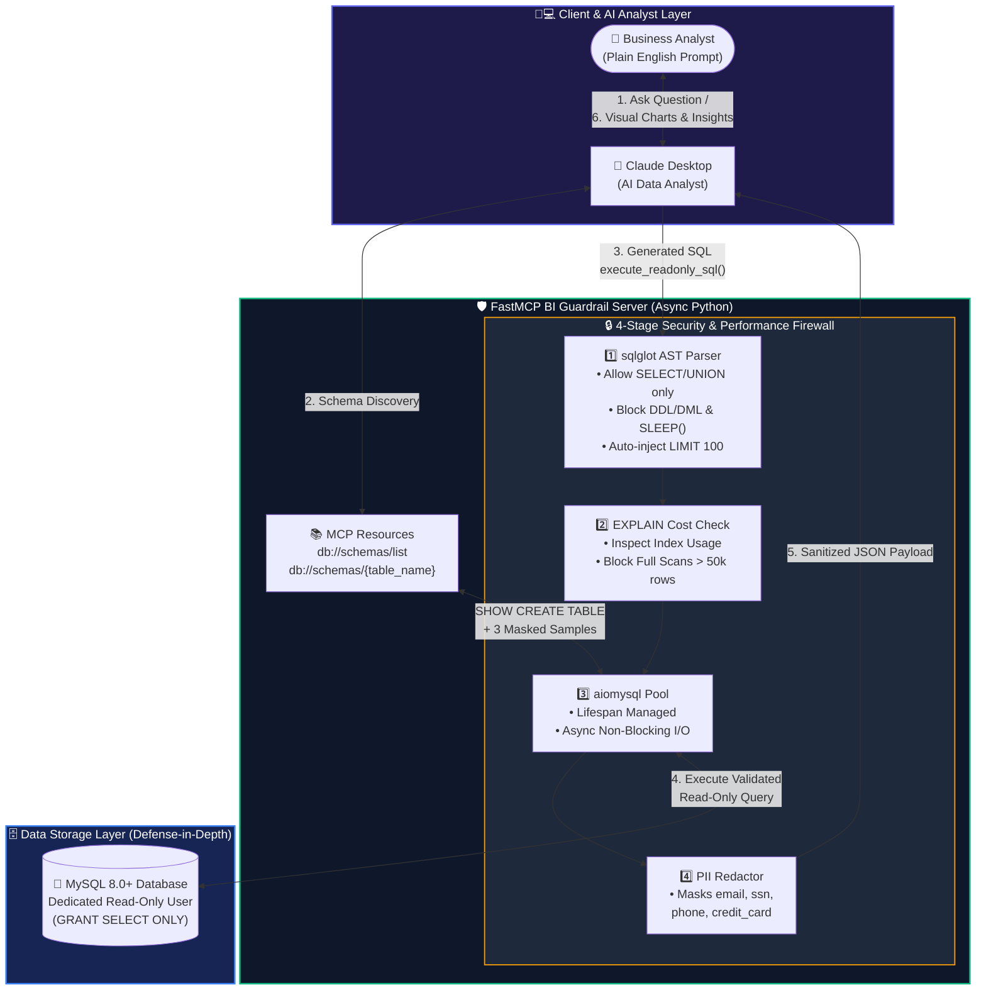

<div align="center">

# 🛡️ Text-to-SQL & Business Intelligence Guardrail MCP Server

**Enterprise-Grade, Schema-Aware AI Data Analyst Bridge with AST Security & Cost Guardrails**

[](https://www.python.org/)
[](https://github.com/jlowin/fastmcp)
[](https://www.mysql.com/)
[](https://github.com/tobymao/sqlglot)
[](https://modelcontextprotocol.io/)

*Empowering business stakeholders to query production databases in plain English—with zero risk of destructive mutations, full-table scan lockups, or PII data leaks.*

</div>

---

## 📋 Table of Contents

- [🚨 The Problem Statement](#-the-problem-statement)
- [✅ How This Server Solves It](#-how-this-server-solves-it)
- [🏗️ System Architecture & Request Pipeline](#️-system-architecture--request-pipeline)
- [🧠 Core Technologies & Terminologies](#-core-technologies--terminologies)
- [📂 Project Structure](#-project-structure)
- [⚙️ Prerequisites & Installation](#️-prerequisites--installation)
- [🔐 Environment Configuration (`.env`)](#-environment-configuration-env)
- [🗄️ Database Setup (MySQL Workbench)](#️-database-setup-mysql-workbench)
- [🚀 Running & Testing the Server](#-running--testing-the-server)
- [🖥️ Connecting to Claude Desktop](#️-connecting-to-claude-desktop)
- [🧪 Security & Performance Guardrail Matrix](#-security--performance-guardrail-matrix)

---

## 🚨 The Problem Statement

In data-driven organizations, business managers and analysts face two major bottlenecks when extracting insights from relational databases:

1. **The SQL & Schema Bottleneck:** Non-technical stakeholders depend on data engineering teams for routine ad-hoc queries because they do not know SQL syntax or complex multi-table schemas.
2. **The Enterprise AI Trust Gap:** While Large Language Models (LLMs) can translate natural language into SQL, **enterprise teams refuse to connect LLMs directly to production databases** due to four critical vulnerabilities:
   - **Destructive Mutations & Prompt Injection:** A misunderstood prompt or adversarial injection could execute `DROP TABLE`, `DELETE`, `UPDATE`, or stacked queries (`; TRUNCATE TABLE`).
   - **Database CPU & Memory Exhaustion:** An unoptimized `SELECT *` without a `LIMIT` clause or an unindexed query triggering a full-table scan across millions of rows can lock production tables.
   - **Context Window Bloat:** Dumping an entire 200-table schema into an LLM prompt wastes tokens, slows inference, and causes column-name hallucinations.
   - **PII Data Leakage:** Raw query results frequently expose sensitive Personally Identifiable Information (`email`, `phone`, `ssn`, `password_hash`) to external model providers.

---

## ✅ How This Server Solves It

This MCP server acts as an **intelligent security, performance, and privacy firewall** between the AI assistant and your MySQL database:

| Capability | Mechanism | Impact |
| :--- | :--- | :--- |
| **100% Read-Only Enforcement** | `sqlglot` AST parsing & deep tree traversal | Blocks all DML/DDL (`INSERT`, `UPDATE`, `DELETE`, `DROP`, `ALTER`), stacked queries, and DoS functions (`SLEEP`, `BENCHMARK`). |
| **Runaway Query Protection** | Programmatic AST `LIMIT` rewriting | Automatically injects or caps `LIMIT 100` on every query before execution so server RAM is never exhausted. |
| **Pre-Flight Cost Guardrails** | Automated MySQL `EXPLAIN` plan inspection | Rejects queries triggering full-table scans (`type == "ALL"`) exceeding `50,000` estimated rows. |
| **Token-Efficient Discovery** | Granular MCP Resources (`db://schemas/{table}`) | Serves exact `CREATE TABLE` DDL + 3 masked sample rows on demand instead of dumping the entire database. |
| **Zero-Leak PII Redaction** | Result-set column interception | Automatically masks sensitive columns (`***REDACTED_PII***`) before returning JSON to the LLM. |

---

## 🏗️ System Architecture & Request Pipeline

### End-to-End Interactive Flow



### Step-by-Step Execution Lifecycle

```text
[1] USER PROMPT     ──► "Which region had the highest revenue last month, and are there outliers?"
[2] SCHEMA LOOKUP   ──► Claude reads `db://schemas/list` ──► inspects `db://schemas/sales_orders`
[3] SQL GENERATION  ──► Claude writes: `SELECT region, SUM(total_amount) FROM sales_orders GROUP BY region`
[4] AST GUARDRAIL   ──► sqlglot verifies pure SELECT + rewrites query with `LIMIT 100`
[5] COST GUARDRAIL  ──► MySQL `EXPLAIN` verifies index usage & safe row scan count (< 50,000)
[6] ASYNC EXECUTION ──► Pooled `aiomysql` connection runs query & redacts any PII columns
[7] BI DELIVERY     ──► Claude receives clean JSON & renders an interactive revenue bar chart
```

---

## 🧠 Core Technologies & Terminologies

| Technology / Concept | Role in Architecture | Why It Matters |
| :--- | :--- | :--- |
| **MCP (Model Context Protocol)** | Open protocol standardizing LLM-to-data integrations via **Resources** and **Tools**. | Decouples database security logic from the LLM client so any MCP-compatible AI can safely query data. |
| **FastMCP** | High-level Python framework for building MCP servers over `stdio` or **Streamable HTTP**. | Provides clean decorators (`@mcp.tool`, `@mcp.resource`), automatic schema generation, and lifespan hooks. |
| **AST (Abstract Syntax Tree)** | Tree representation of syntactic SQL structure generated by `sqlglot`. | Unlike regex (which attackers bypass using comments like `/* */ DELETE`), AST inspection validates the structural intent of every token and subquery. |
| **`sqlglot`** | Zero-dependency SQL parser, transpiler, and AST optimizer. | Parses MySQL dialect queries, blocks forbidden AST node types, and programmatically appends `.limit(100)`. |
| **`aiomysql`** | Asynchronous MySQL client built on Python `asyncio`. | Prevents database I/O from blocking the event loop, enabling high concurrency across simultaneous queries. |
| **Connection Pooling** | Pre-warmed pool of reusable TCP database connections (`minsize=2`, `maxsize=10`). | Eliminates per-query TCP/TLS handshake latency and protects MySQL from connection exhaustion. |
| **`@asynccontextmanager` (`lifespan`)** | FastMCP startup/shutdown lifecycle hook. | Initializes the `aiomysql` pool once at boot (`yield`) and gracefully closes all sockets on exit (`finally`). |
| **MySQL `EXPLAIN` Plan** | Query optimizer execution plan diagnostic. | Exposes `type` (`ALL` vs `ref`/`range`) and estimated `rows` scanned before touching table data. |
| **Defense-in-Depth** | Multi-layered security posture. | Combines Python AST validation + `EXPLAIN` limits + PII redaction + a MySQL user restricted strictly to `GRANT SELECT`. |

---

## 📂 Project Structure

```text
Text_to_SQL_Business_Intelligence_and_Guardrail_MCP_Server/
├── .venv/                  # Isolated Python virtual environment managed by uv
├── src/                    # Application source directory
│   └── main.py             # FastMCP server, AST guardrails, EXPLAIN checks, and PII redaction
├── .env                    # Local database credentials (gitignored — never commit!)
├── .gitignore              # Excludes .env, .venv, and Python cache artifacts
├── pyproject.toml          # Project metadata and locked dependencies
└── README.md               # Architecture and setup documentation
```

---

## ⚙️ Prerequisites & Installation

### 1. System Requirements
- **Python 3.11+**
- **MySQL Server 8.0+** & **MySQL Workbench**
- **`uv`** (Fast Python package & environment manager)
- **Node.js / `npx`** (Required for the MCP Inspector and `mcp-remote` bridge)

### 2. Clone & Install Dependencies

```bash
git clone https://github.com/<your-username>/<your-repo-name>.git
cd <your-repo-name>

# Install dependencies using uv
uv sync
# Or add packages directly:
uv add fastmcp sqlglot aiomysql pydantic python-dotenv
```

---

## 🔐 Environment Configuration (`.env`)

Create a `.env` file in the root directory of the project. *(Ensure `.env` is added to your `.gitignore` file.)*

```env
EXAMPLE

MYSQL_HOST=localhost
MYSQL_PORT=3306
MYSQL_USER=readonly_analyst
MYSQL_PASSWORD=ChangeMe123!
MYSQL_DATABASE=company_bi
```

| Variable | Description |
| :--- | :--- |
| `MYSQL_HOST` | Hostname or IP address of your MySQL server (`localhost` for local development). |
| `MYSQL_PORT` | TCP port MySQL is listening on (default: `3306`). |
| `MYSQL_USER` | Dedicated MySQL user account configured with read-only (`SELECT`) privileges. |
| `MYSQL_PASSWORD` | Password for the read-only MySQL account. |
| `MYSQL_DATABASE` | Target database schema exposed to the BI server. |

---

## 🗄️ Database Setup (MySQL Workbench)

Execute the following SQL script in **MySQL Workbench** to initialize a sample database, populate test records (including an `email` column to verify PII masking), and create a restricted read-only MySQL user:

```sql
-- 1. Create the target analytics database
CREATE DATABASE IF NOT EXISTS company_bi;
USE company_bi;

-- 2. Create a sample sales table with an indexed date column and a PII column
CREATE TABLE IF NOT EXISTS sales_orders (
    order_id INT AUTO_INCREMENT PRIMARY KEY,
    customer_name VARCHAR(100),
    email VARCHAR(150),
    region VARCHAR(50),
    total_amount DECIMAL(10, 2),
    order_date DATE,
    INDEX idx_order_date (order_date)
);

-- 3. Insert sample records
INSERT INTO sales_orders (customer_name, email, region, total_amount, order_date) VALUES
('Aarav Sharma', 'aarav@example.com', 'North America', 14500.00, '2026-11-10'),
('Priya Patel', 'priya@example.com', 'Europe', 8200.50, '2026-11-12'),
('Rohan Verma', 'rohan@example.com', 'North America', 22000.00, '2026-11-15'),
('Sneha Nair', 'sneha@example.com', 'Asia Pacific', 4300.75, '2026-11-18');

-- 4. Create a strictly read-only database user (Defense-in-Depth)
CREATE USER IF NOT EXISTS 'readonly_analyst'@'localhost' IDENTIFIED BY 'ChangeMe123!';
GRANT SELECT ON company_bi.* TO 'readonly_analyst'@'localhost';
FLUSH PRIVILEGES;
```

---

## 🚀 Running & Testing the Server

### Option A: Interactive Testing via FastMCP Dev & MCP Inspector

```bash
uv run fastmcp dev main.py
```

This launches the browser-based **MCP Inspector** where you can:
1. Browse **`db://schemas/list`** and **`db://schemas/sales_orders`** under **Resources** to verify DDL retrieval and PII masking.
2. Invoke **`execute_readonly_sql`** and **`explain_query_plan`** under **Tools** to test valid aggregations and verify destructive queries are blocked.

### Option B: Remote Streamable HTTP Server Mode

Ensure the entrypoint at the bottom of `main.py` is configured for HTTP transport:

```python
if __name__ == "__main__":
    mcp.run(transport="http", host="0.0.0.0", port=8000)
```

Start the server:

```bash
uv run python main.py
```

Your remote MCP endpoint is now live at `http://localhost:8000/mcp`.

---

## 🖥️ Connecting to Claude Desktop

Add the server configuration to your `claude_desktop_config.json`:
- **Windows:** `%APPDATA%\Claude\claude_desktop_config.json`
- **macOS:** `~/Library/Application Support/Claude/claude_desktop_config.json`

```json
{
  "mcpServers": {
    "mysql-bi-analyst": {
      "command": "npx",
      "args": [
        "-y",
        "mcp-remote",
        "http://localhost:8000/mcp"
      ]
    }
  }
}
```

Restart Claude Desktop completely and prompt:
> *"Inspect my database schema, calculate total revenue by region, and render a visual bar chart."*

---

## 🧪 Security & Performance Guardrail Matrix

| Test Case | Input SQL Query | Guardrail Action & Output |
| :--- | :--- | :--- |
| **Valid BI Aggregation** | `SELECT region, SUM(total_amount) FROM sales_orders GROUP BY region` | Rewrites AST to append `LIMIT 100`, validates `EXPLAIN`, executes safely, returns JSON. |
| **Destructive Mutation** | `DELETE FROM sales_orders WHERE total_amount < 5000` | `❌ Security Guardrail Blocked: Operation 'DELETE' is forbidden. Read-only access only.` |
| **Stacked SQL Injection** | `SELECT * FROM sales_orders; DROP TABLE sales_orders;` | `❌ Security Guardrail Blocked: Only a single SQL statement is permitted.` |
| **Time-Based DoS Attack** | `SELECT SLEEP(30)` | `❌ Security Guardrail Blocked: Forbidden MySQL function: SLEEP` |
| **Unbounded Full Scan** | `SELECT * FROM large_logs_table` (`> 50,000` rows, `type: ALL`) | `⚠️ Performance Guardrail Blocked: Full-table scan detected. Add an indexed WHERE filter.` |
| **PII Column Query** | `SELECT customer_name, email FROM sales_orders` | Automatically masks sensitive fields: `"email": "***REDACTED_PII***"`. |
